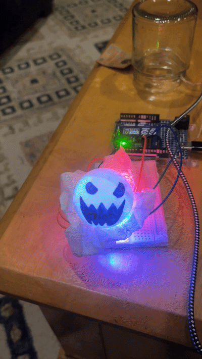

10.20.26

# Week 9: Physical Computing Kickoff + Arduino Basics

# Assignment:

### Homework for today (10.20)
- Install the Arduino software
- Review Dr. Sudhu's [Arduino Tutorial](https://github.com/loopstick/ArduinoTutorial)
- Take Lady Ada's [Arduino tour](https://learn.adafruit.com/ladyadas-learn-arduino-lesson-number-0)

### In class
- Picked up our electronics kits
- Started the Arduino tutorial, aiming to get up to the RGB LED section

**First blink:** a little Arduino ghost lamp

# Lecture Notes:

- New section of TDF: **Physical Computing**. Instructors are Chris Myers (fabrication) and Sudhu Tewari (electronics and programming); Alistair Vizuet is the GSI
- Section layout:
  - **0 - The basics (2 weeks):** laser-cut rings, 3D-printed rings, microcontroller exercises
  - **1 - Expressive Mechanics (1.5 weeks):** Arduino + p5.js, computer vision, mechanical movement, due Nov 12
  - **2 - Ambient Display (3 weeks):** ESP32 + web API, display through light, water or movement, "museum quality," due Dec 8 at the Jacobs Design Showcase
- Rhythm: Tuesdays = electronics, Thursdays = fabrication and prototyping, 2 journal entries a week
- **Kit:** Elegoo Arduino Uno R3, breadboard, jumper wires, servo, ultrasonic sensor, PIR sensor, LEDs, RGB LEDs, photoresistors (LDRs), potentiometers, buttons, H-bridge, DC motor, solenoid, microphone, NeoPixel strip
  - "Advanced stuff" (ESP32 Feather, haptic driver, gesture/color sensor, accelerometer) stays sealed until later
- **Resistors:** read the color bands, or use a [color code calculator](https://www.digikey.com/en/resources/conversion-calculators/conversion-calculator-resistor-color-code)
  - 330Ω → regular LEDs
  - 470Ω → RGB LEDs
  - 10kΩ → LDRs and switches

## Reflections:

- With my engineering background, it felt good to be back somewhere familiar with hardware
- That said, I'm looking to branch out from mechanical and mechanism design, so I'm curious to explore projects through other means this section

## Speculations/Questions:

- How much of what we learned with AI agents carries over to working with physical parts?
