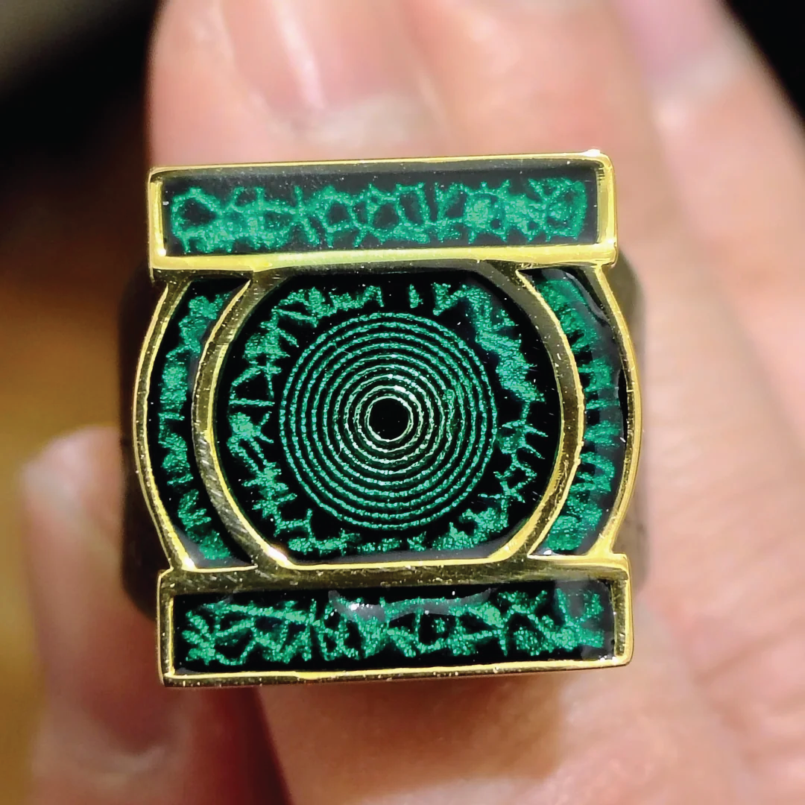
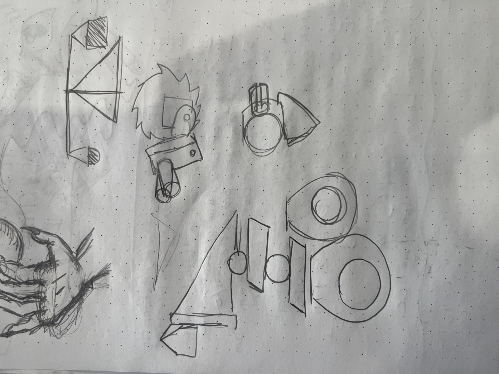
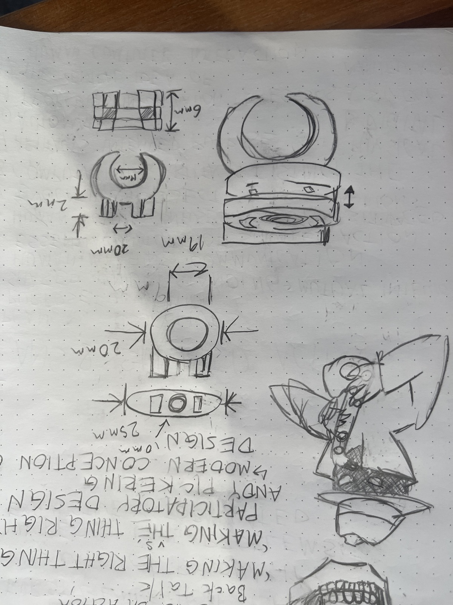

10.22.26

# Week 9: Laser Cutting + Joinery, Ring Prep

# Assignment:

### Homework for today (10.22)
- Complete the online laser cutter training
- Install Adobe Illustrator and Fusion 360 from software@berkeley

### Laser Cut Ring: Phase 1 (concept + prep)
**Brief:** Create a ring that describes a part of your personality or a cause you believe in. Make it bold, make it big.
- **Simplicity:** rings are small, so think big shapes, not tiny details
- **Fit:** measure the finger carefully
- **Finish:** sand off sharp and burnt edges
- **Illustrator setup:** cut lines are RGB red (255) at 0.001" stroke

**Starting point: Arduino experience**
- I came into this section with Arduino experience from my engineering background and other projects, so I wanted the ring to be more than just a cut shape
- **Concept:** a **Green Lantern ring** with an embedded magnet that lights up a matching lantern when the ring comes near

**Reference:**

**Sketches:** first ideas, then a stacked-layer ring with dimensions (19mm finger hole, 20–25mm face, layers stacked to about 6mm thick)

# Lecture Notes:

- **Laser cutting** cuts, etches and rasters sheet material from a 2D file
  - Good: fast, precise, consistent, little waste, works on lots of materials, one tool replaces many
  - Limits: uses a lot of energy, only cuts flat sheets, some materials are dangerous to cut
- **Joining techniques:**
  - **Finger joints:** the most used and abused. A few simple tabs look good; too many tabs look amateur ("no Etsy!")
  - **Mortise and tenon:** a tab through a slot, so the top and bottom can have curves or details
  - **Captive nut T-slot:** a screw and nut held in a T-shaped cutout, so parts can come apart
  - **Stack and frame:** stack flat layers to build up thickness (how my ring is built)
  - **Snap hooks:** tab-in-slot enclosures that click together
- **Kerf bending / flexures:** rows of staggered cuts let rigid sheets bend
  - Tighter cuts bend more but snap more easily, so it's a balance

## Reflections:

- The full concept (a ring with embedded magnets that lights up a matching lantern) is probably more than a one-week project, but I'm excited to try it

## Speculations/Questions:

- When is a laser-cut joint better than just gluing?
- How small can the electronics get and still fit inside a lantern?
