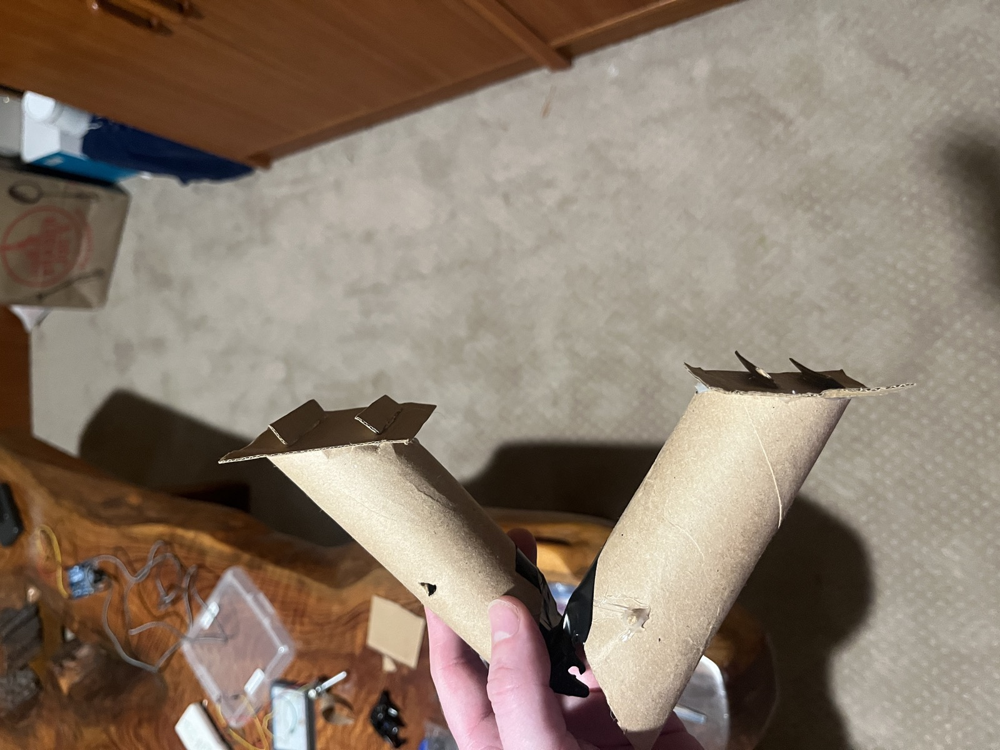
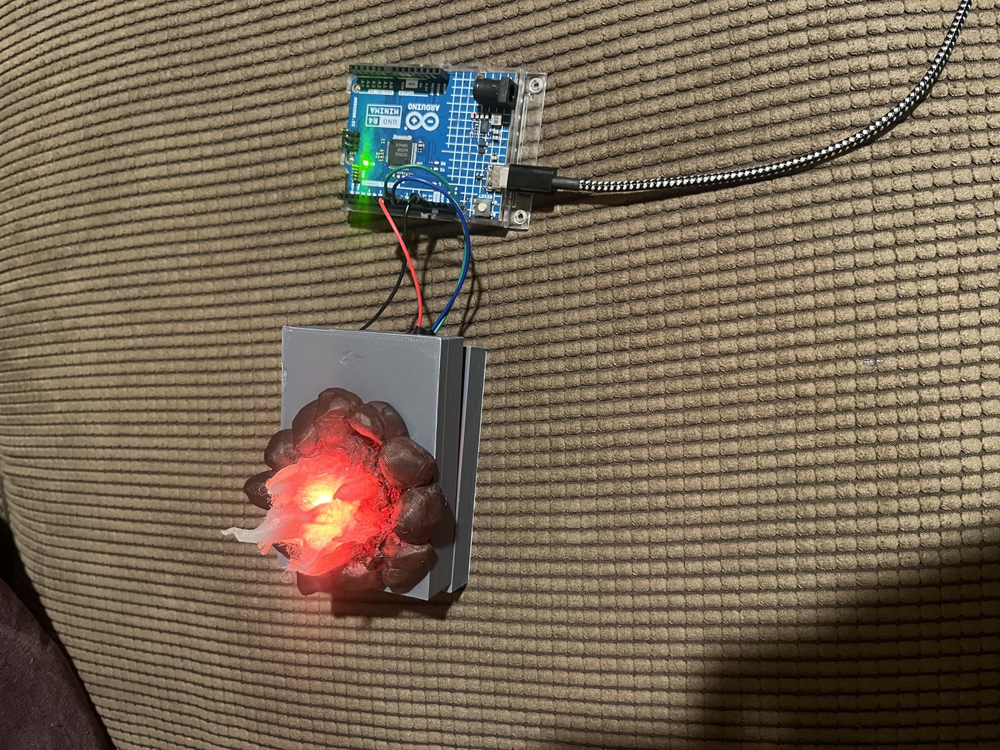

10.27.26

# Week 10: More Arduino

# Assignment:

### Homework for today (10.27)
- Write a program that flashes the onboard LED while printing "Hello World" to serial
- Make "something interesting" happen with:
  - 1 LED + 1 LDR
  - 2 or more LEDs
- Document: 1 video, images, code, circuit diagram, short write-up

### What I made: Sonic Circuit
This week I was also working on **Sonic Circuit**: a drivable toy car controller that plays a p5.js kart-style game where your driving controls the music.
- **Potentiometer = steering wheel:** steering positions add harmony intervals
- **FSR (force sensor) = gas pedal:** pressing harder speeds up the song's tempo
- **LDR in a keyhole = turbo:** turning the key lets light in and the song distorts
- The Arduino sends all three readings to p5 over Web Serial (115200 baud) as `pot,fsr,ldr`
- Before the 3D-printed car parts arrived, I built a test kit (`SonicCircuit_test`) to check each sensor and its sound on its own

<!-- TODO: Sonic Circuit / Tire Tracks photo or video -->

### Other Arduino experiments
- **Crawling robots**

https://youtube.com/shorts/KKauU4rQ_Ok

- **Gamified music controllers:** Sonic Circuit / Tire Tracks (above)
- **Adjustable campfire LEDs:** a 3D-printed campfire lit by LEDs

### Homework for next Tuesday (11.3)
- Make "something interesting" happen with a servo motor and an ultrasonic or PIR sensor

# Lecture Notes:

- Started with a walk-around: show classmates what you got working over the week
- **Journal requirements for this section:**
  - 2 entries a week (electronics + fabrication)
  - Visuals, text and evidence of iteration
  - **1 diagrammatic analysis of a system per journal submission** (not per entry)
  - Submit the link on bCourses with each project
- **Wire color codes:**
  - Red/orange = power (TDF: red 5V, orange 3.3V, yellow 12V)
  - Black/green = ground (GND, 0V)
- **Voltage divider:** two resistors in series split a voltage. This is how an LDR turns light into a reading the Arduino can measure
- **Soldering:** watched a [solder tutorial](https://www.youtube.com/watch?v=IPec237T18U)

## Reflections:

- The skills from Arduino projects like these can be applied to all kinds of phygital (physical + digital) interactions across a lot of disciplines: games, music, lighting, robotics

## Speculations/Questions:

- What counts as a "diagrammatic analysis" for a project this small?
