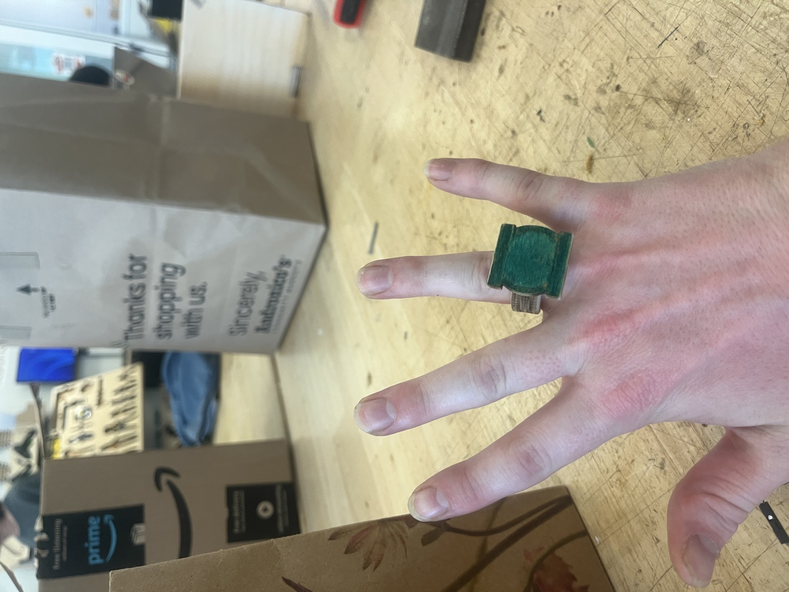

10.29.26

# Week 10: Green Lantern Ring + 3D Printing

# Assignment:

### Laser Cut Ring: Green Lantern

My ring is a laser-cut, Green Lantern–style ring with a magnet in it. Bring the ring near a lamp and it lights up green, like a power ring charging.



<!-- TODO: IMG 1324 (all ring components together) + video of the lantern lighting up -->

**How it works:**
- A **reed switch** (a switch that closes near a magnet) is wired to the Arduino
- When the ring comes close, the switch closes and the LED turns on
- Take the ring away and the LED turns off

**Iterations:**
1. `GreenLantern_test`: checking that the reed switch could actually feel the magnet through the ring
2. `GreenLantern_simple`: the LED is just on while the ring is near and off when it isn't
3. `GreenLantern`: the full version. The light fades up to "lantern green" in about 0.75s, stays on for 1s after the ring leaves, then fades out over about 1.5s. A debounce stops the switch from flickering

**Wiring:**
- Reed switch → pin 2 and GND (uses the Arduino's built-in pull-up, so no resistor)
- LED → 220Ω resistor → pin 9 (the RGB LED version uses pins 9 / 10 / 11)

```cpp
// GreenLantern_simple: the core idea in a few lines
void loop() {
  if (digitalRead(reedPin) == LOW) {   // magnet is close
    digitalWrite(ledPin, HIGH);
  } else {
    digitalWrite(ledPin, LOW);
  }
}
```

**Links and references:**
- Class deck: [Laser Cut Rings – PhysComp Group 2](https://docs.google.com/presentation/d/1N4XDP0e6PVJZBquaUR0Bz-f5iqF7R3smtu48ARH2tw4/edit), slide 15 ("Evan Bowman – Green Lantern Power Ring")
- Concept, reference image and sketches: [10.22 entry](../Week09/10_22_26.md)
- Assignment and joinery techniques: 10.22 lecture, [2026 TDF – PhysComp class 02 – Lasercutting & Joinery](https://docs.google.com/presentation/d/1-87_Yme902Xp8mzEedjsxOBXPSOtPjYNKCR12lRxxvY/edit)
- Code: `GreenLantern_test`, `GreenLantern_simple`, `GreenLantern` (Arduino sketches, iterations described above)

### 3D Printed Rings (due 11.5): see the [11.05 entry](../Week11/11_05_26.md) for my Sunburst Ring
- **Part 1:** reprint the laser-cut ring as an exact copy (import the Illustrator file into Fusion, extrude 3mm). It's fine if it prints badly; the point is to compare laser cutting and 3D printing
- **Part 2:** design a second ring *for* 3D printing. No walls under 1.5mm, no details under 1mm. Be creative, experimental and bold

# Lecture Notes:

- **Gears and linkages:** design starts with a sketch with notes and callouts
  - Build low-fi first using anything stable → quick fabrication to check → add parts → laser cut
  - Make motor mounts and shaft adapters
  - **Tolerance test**, then **sand everything** to reduce friction
  - Loop: *test → tolerance → build → sand → repeat*
  - Expressive Mechanics tip: one simple mechanism, repeated
  - Resource: [ciechanow.ski/gears](https://ciechanow.ski/gears/)
- **Three ways to make things:**
  - **Additive** (3D printing): low volumes, complex shapes, fast
  - **Subtractive** (milling, turning): medium volumes, tight tolerances, hard materials
  - **Formative** (injection molding, stamping): high-volume identical parts
- **A short history:** Chuck Hull is usually credited with SLA (1984) and the STL file (1987). Kodama (1981), Deckard (SLS, 1987) and Crump (FDM, 1989) were also early
- **FDM materials:**
  - PLA: cheap, strong, easy; softens around 50°C
  - PETG: tougher, handles about 70°C, absorbs moisture
  - ABS/ASA: about 100°C, but needs an enclosure
  - TPU: flexible, print it slow
- **Settings for success:** go big, layer height 0.20+, infill under 15%, use a brim for bed adhesion

## Reflections:

- The ring started as a fabrication assignment, but adding the reed switch made it the first time the two halves of this section (fabrication + electronics) met in one object
- First time using reed switches, and I was pleased with how it turned out
- **Next iteration:** a brighter LED, and better electronics packaging so everything sits in the bottom of the lantern. Eventually make it wireless
- It would've made an excellent Halloween costume prop if I'd finished it in time!
- Overall a fun project. I may have put in a bit too much extra work to realize my vision with the electronics and 3D printing, but that's part of the fun and struggle of being a designer: how and what do you pour your time and passion into?

## Speculations/Questions:

- How different will the same ring feel printed vs. laser cut?
