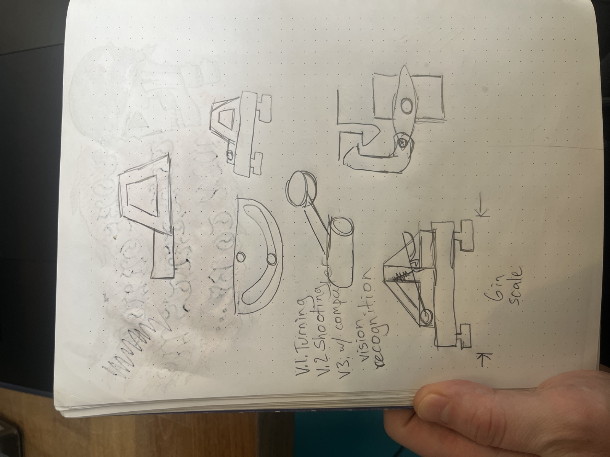

11.03.26

# Week 11: Expressive Mechanics Kickoff + p5.js

# Assignment:

### Homework for Thursday (11.5)
- 3D printed rings: add photos to the class slide deck
- Bring a working Arduino + servo (or motor) + computer vision setup (based on the class demo *TDF_ComputerVision_HeadPositionControlsServo*)

### Project 1: Expressive Mechanics (due 11.12)
**Brief:** "Give the machine emotions." Build a kinetic sculpture with (electro)mechanical movement (servo, DC motor + H-bridge, or solenoid), controlled by computer vision through Arduino + p5.js.

### My first concept: The Candy Catapult
In class, the professor tosses candy to people who answer questions. My idea was to automate that:
- p5.js + ml5 watches the class through the webcam
- When someone **raises their hand**, the catapult aims at them and **lobs a piece of candy**
- Two servos: one to **aim**, one to **release** the trigger
- The first prototype was based on an [automatic rubber band catapult](https://www.instructables.com/Automatic-Rubber-Band-Catapult/). The band stays loaded from a fixed anchor and a tab-fit lock holds it until the release servo lets go

**Concept sketch:** a 6-inch-scale catapult on a base with feet, a curved slot for turning, and a trigger/latch detail. I planned to build it in versions:
- **V.1:** Turning (aim)
- **V.2:** Shooting
- **V.3:** with computer vision recognition

# Lecture Notes:

- **Demo:** head position (seen by the webcam) controls a servo. The p5 example comes with Arduino code and a Fritzing diagram
- **Inspiration:** Neil Mendoza and Reuben Margolin (kinetic sculpture)
- **Processing → p5.js:**
  - Processing (2001, Casey Reas + Ben Fry): coding through visual art
  - p5.js (2013, Lauren McCarthy): Processing for the web
- **Building it up:**
  - p5 alone = generative/reactive art, but no physical world
  - Arduino + p5 = visualize sensor data, sync on-screen and off-screen events
  - Arduino + p5 + webcam = computer vision controlling real things
  - add a web API = "world domination" (and the basis of the next project, Ambient Display)
- **Web Serial (p5 ↔ Arduino):**
  1. Wire up a sensor (e.g. potentiometer on A0)
  2. Arduino reads it and sends it over serial with `Serial.begin(115200)`
  3. The p5 template sketch reads it in the browser (it also works the other way: p5 → Arduino)
- **Computer vision in p5:** ml5 PoseNet for skeleton tracking (the Nose-ifier, Nose + Hat examples)
- Places to explore: p5js.org/examples, OpenProcessing

## Reflections:

- I already had a Web Serial connection working from Sonic Circuit, so the p5 ↔ Arduino part felt familiar. The new parts were the mechanism and the computer vision
- There were a lot of decisions to make for the catapult. Sketching was a good start, but it would've been best to start **cardboard prototyping earlier**, to think with my hands and get the ideas out of my head
- The catapult was mechanically dense, with so many branching decision paths. The best method would have been to **choose a lane and stick with it**

## Speculations/Questions:

- How do you make a machine feel *expressive* and not just functional?
- Can a catapult be accurate enough to hit a specific person?
