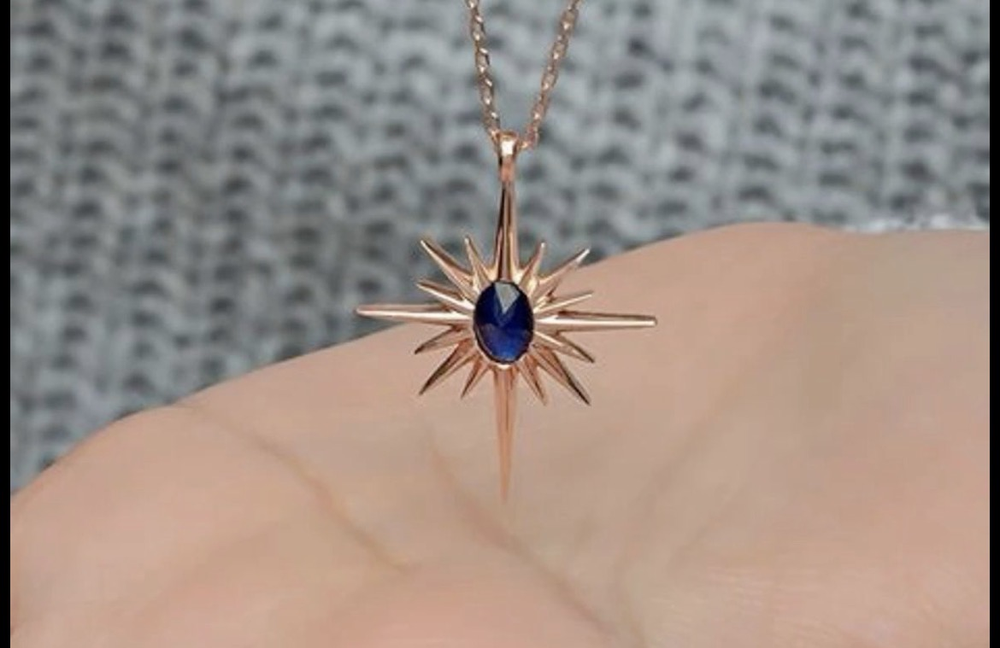
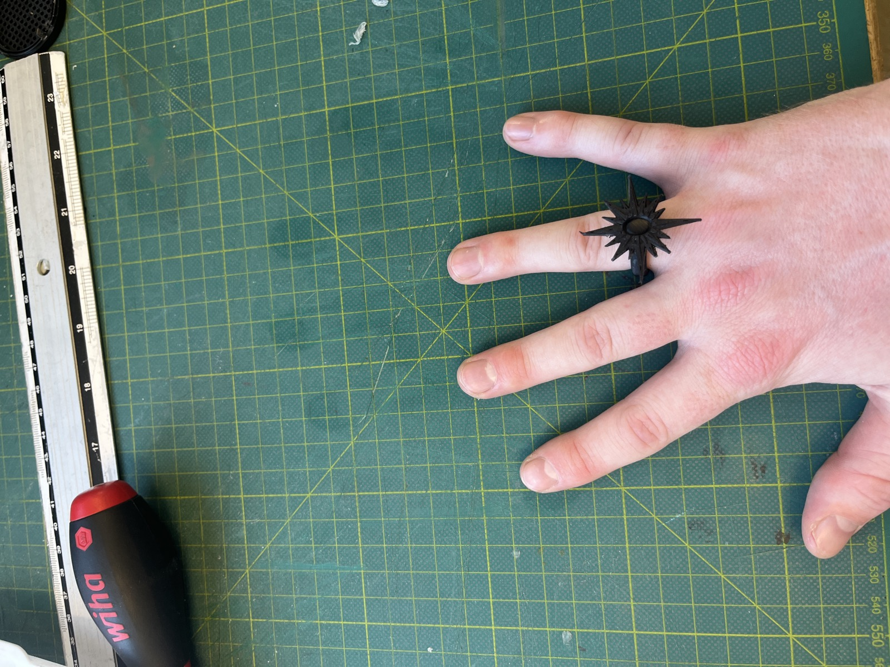
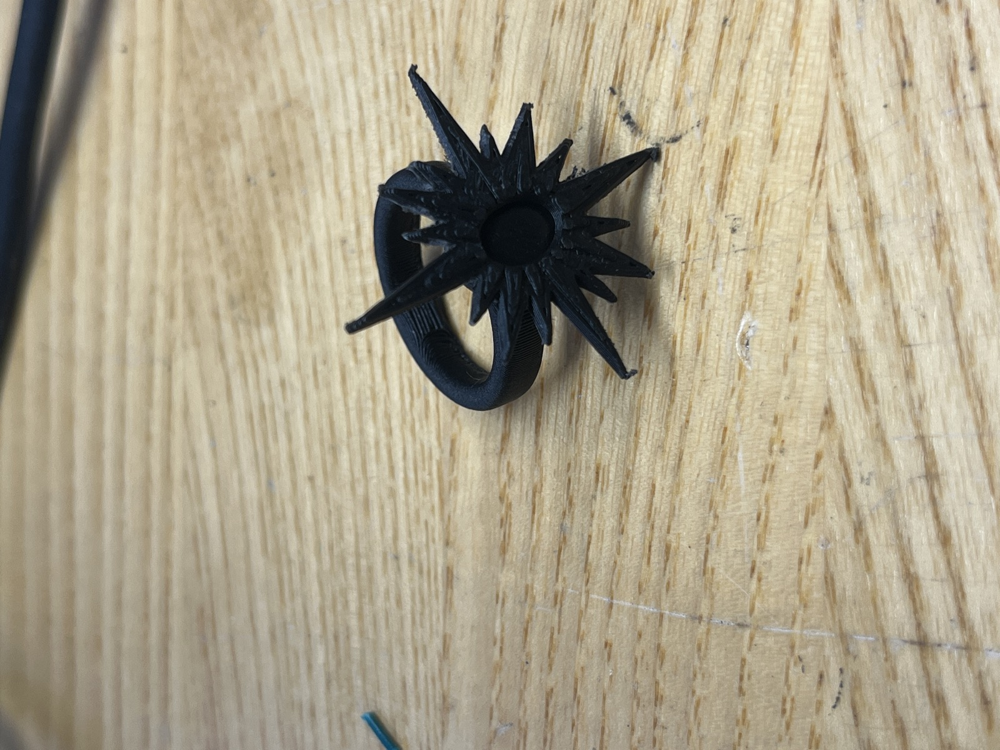

11.05.26

# Week 11: Sunburst Ring, Servos + Building the Catapult

# Assignment:

### 3D Printed Ring: Sunburst Ring (due today)
**Brief** (from the 10.29 lecture):
- **Part 1:** reprint the laser-cut ring as an exact copy, to compare laser cutting and 3D printing
- **Part 2:** design a second ring *for* 3D printing. No walls under 1.5mm, no details under 1mm. Be creative, experimental and bold

**Concept:** I designed my 3D-printed ring off a piece of my own jewelry, a **sunburst pendant** with a blue oval stone in the middle. It's an eight-point star with long rays, short rays in between, and an oval setting in the center.

**Result:** a black FDM print. A plain band with the sunburst on top, and a recessed oval in the center where the stone sits on the pendant.

**What I noticed:**
- The big shape reads clearly on the hand. It's bold and big, like the brief asked
- The **thin ray tips came out rough and stringy**. The tips are the details closest to the 1mm limit
- Compared to the laser-cut Green Lantern ring, 3D printing let me make a **rounded band and a raised, layered face in one part**, with no stacking or gluing

<!-- TODO: Part 1, the 3D-printed copy of the Green Lantern ring (photo + how it compared) -->

**Links and references:**
- Class deck: [3D Printed Rings – PhysComp Group 2](https://docs.google.com/presentation/d/1MNDuoe-tSOIRwDe6s9OEMLAQY2g8Jbg9DZllgdywxdg/edit), slide 11 ("Evan Bowman – Sunburst Ring")
- Assignment and print settings: 10.29 lecture, [2026 TDF – PhysComp class 18 – 3DP & Additive Manufacturing](https://docs.google.com/presentation/d/1s6OeOcqMPJJnHkrGICaqrN-JMgnj0ZF_V-FH73DgvfY/edit)
- Printing basics: [CNC Kitchen beginner 3D printing guide](https://www.cnckitchen.com/blog/the-beginner-3d-printing-guide-i-wish-i-had), [PrusaSlicer UI overview](https://help.prusa3d.com/article/ui-overview_1766)
- Previous ring: [Green Lantern laser-cut ring (10.29)](../Week10/10_29_26.md)

### Homework for next Tuesday (11.10)
- Work on Expressive Mechanics: experiment with mechanisms and computer vision, PLAY!
- Document: 1 video, images, code, circuit diagram, short write-up

## Expressive Mechanics: Catapult Progress
The plan from 11.03: the webcam sees a raised hand → the catapult aims → it lobs candy.

- Starting point: an [automatic rubber band catapult](https://www.instructables.com/Automatic-Rubber-Band-Catapult/), adapted for two servos
  - **Servo 1:** aims the catapult
  - **Servo 2:** releases a **clip** that holds the loaded arm
- p5 → Arduino over Web Serial, reusing the connection code from my TUI Sonic Circuit project

<!-- TODO: first sketches / first cut parts / photos of the build so far -->

# Lecture Notes:

- **Rings:** voted on the laser-cut and 3D-printed rings
- **Gears and linkages** (recap): sketch → low-fi → quick fab → tolerance test → sand → repeat
- **Servos are great:** they make things move under precise control
  - Attaching the servo to the mechanism is the hard part. Simple things cause a lot of confusion
  - **Pushrods** are the simplest way to connect a servo to a mechanism. They can be as basic as a single piece of wire ([Adafruit pushrod guide](https://learn.adafruit.com/pushrod-garage/pushrod-mechanism))
  - Or connect the servo **directly** to the mechanism to cut complexity
- Expressive Mechanics sketch share-out

## Reflections:

<!-- TODO -->

## Speculations/Questions:

- What's the simplest way to make a servo release something under tension?
