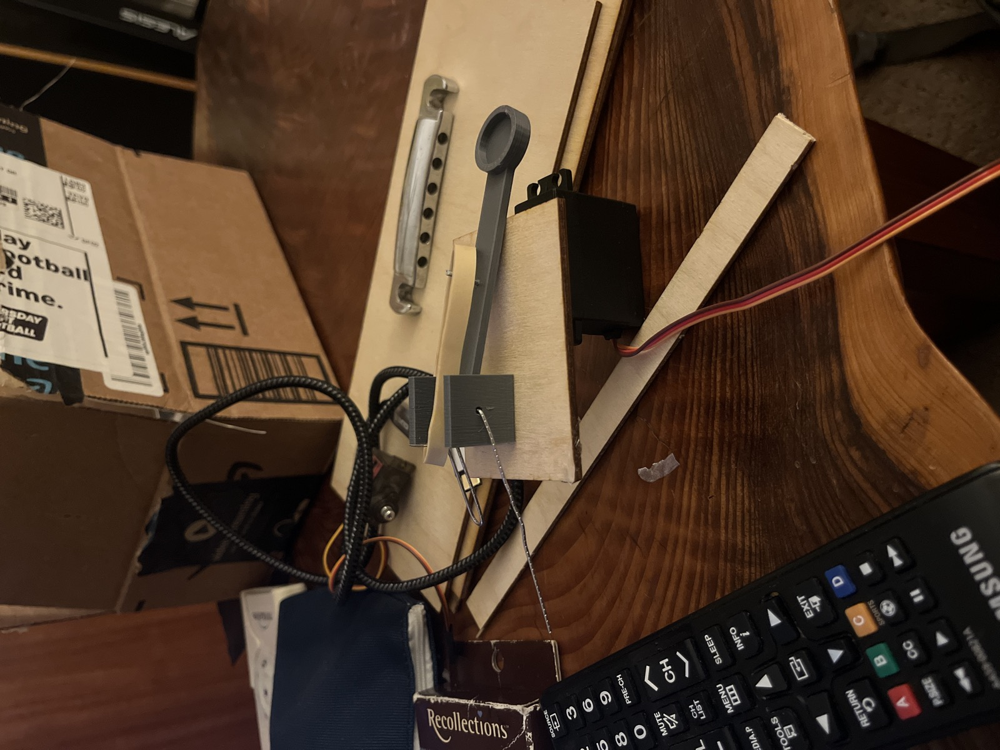
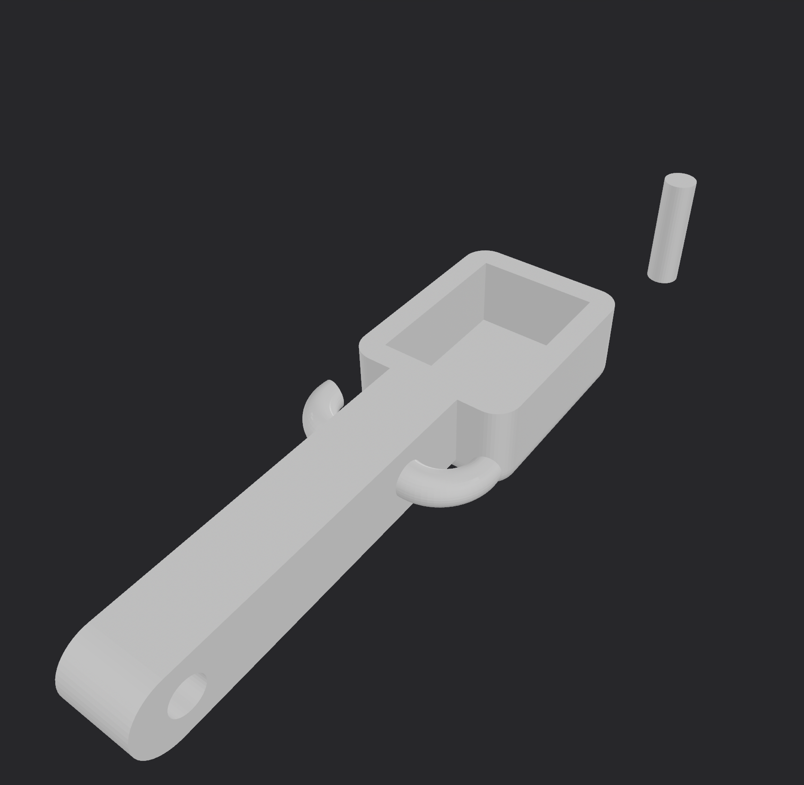
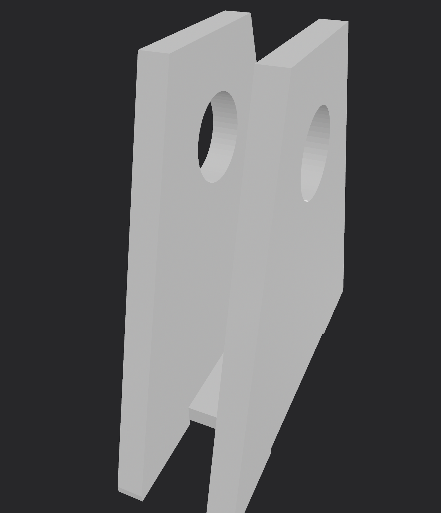

11.10.26

# Week 12: Expressive Mechanics Working Session: Catapult Iterations

# Assignment:

- Work on Expressive Mechanics before the 11.12 critique

## Where the catapult stood
I had a **3D-printed prototype that worked when adjusted by hand**, but it wasn't automated by servos the way I wanted it to be.

*The prototype: a 3D-printed arm with a cup, a rubber band, and a wire pin through a printed block as the catch. It sits on a plywood platform mounted on a servo for turning.*

## Experiments

### 1. The trigger
- **Design:** a clip holds the loaded arm, and the release servo pulls the clip to fire
- **Result:** the clip interaction kept failing with the servo
- **Next:** started developing a new trigger that would actually work with the servo mechanism
<!-- TODO: what the new trigger looked like and how far it got -->

### 2. The arm
Going from existing catapult designs to my own, built custom for the candy and the size of the project, meant major adjustments to:
- **Fit the candy:** the end of the arm had to actually hold a piece of candy
- **Spring force:** the springs had to be strong enough to throw the candy without overpowering the trigger
- **Alignment:** the arm had to line up so the catapult shot straight and consistently

**Arm v2 (redesign after the first printed arm):** a square candy cup, pins for attaching springs, a pivot hole at the end, and a separate pivot pin

**Pivot supports CAD:** two uprights with matching holes for the arm's pivot pin

**What happened when I printed v2:**
- **Spring pins too big:** I didn't realize the circumference of the pins I'd designed for the springs was too big for the springs to fit on
- **Wrong kind of spring:** I only had **compression springs**. What I actually needed were **tension springs with hooks on the ends** so they could hook onto the pins
- **Lesson:** check the real parts I have (spring type and size) *before* designing around them, and do a quick tolerance test on small features like pins before printing the whole arm

### 3. Everything else
On top of the trigger and the arm, the catapult also had to **aim** and **integrate computer vision**. That's several different mechanisms, each needing its own testing and iterations.

## What I noticed
- Every fix touched something else. A stronger spring meant more load on the trigger; a new arm meant re-aligning everything
- I wanted to automate both the trigger *and* the reloading. In hindsight, **choosing one** (just automating the trigger, and loading by hand) would have been a stronger direction
- I would have done myself a favor by planning the tests a bit ahead of time

# Lecture Notes:

- Working session, no lecture

## Reflections:

- My vision and desire for a perfect automated catapult got in the way of what I could realistically accomplish in a week and a half
- At this point it would've been wise to simplify the mechanism and focus on automating just the trigger
<!-- TODO -->

## Speculations/Questions:

- Should I keep pushing the catapult, or find a simpler version of the idea?
