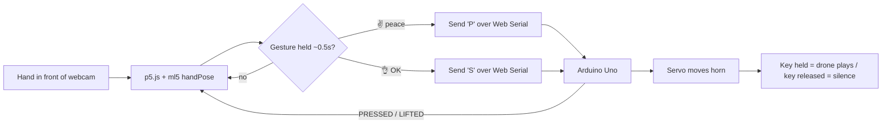

11.12.26

# Week 12: Expressive Mechanics Critique: The Pivot to Horn Drone

# Assignment:

### Expressive Mechanics: Final (critique today)

## The Pivot
I couldn't get the catapult dialed in the way I wanted, so I made a last-minute pivot to something simpler that I could get fully working: **Horn Drone**, a servo-powered horn that presses down a keyboard key to play a drone note, controlled by hand gestures.

It keeps the parts of the catapult that already worked (webcam → p5 → Web Serial → Arduino → servo) and drops the parts that didn't (the trigger, springs and projectile).

<!-- TODO: photo + video of the horn playing -->

## How it works
- p5.js + **ml5 handPose** watches my hand through the webcam
- ✌️ **Peace sign** held ~0.5s → sends `P` → the servo swings the horn down and holds the key (PLAY)
- 👌 **OK sign** held ~0.5s → sends `S` → the horn lifts off the key (STOP)
- Keyboard backup: press P / S
- The Arduino replies `READY` / `PRESSED` / `LIFTED` so the page knows what happened

**Small details that mattered:**
- The gesture has to be **held for ~0.5s** before it fires, so a passing hand doesn't trigger it
- The servo moves **one degree at a time** so the horn doesn't slam the key
- Only two numbers to tune: the resting angle (90°) and the pressing angle (30°)

**Wiring:**
- Servo signal → pin 9
- Servo power → 5V (external supply if it stutters), ground shared with the Uno

```cpp
void loop() {
  if (Serial.available() > 0) {
    char c = Serial.read();
    if (c == 'P') { moveTo(PRESS_ANGLE); Serial.println("PRESSED"); }
    else if (c == 'S') { moveTo(REST_ANGLE); Serial.println("LIFTED"); }
  }
}
```

## System Diagram: Horn Drone



## Critique
- I wasn't able to make the critique because of my last-minute pivot, which was a lesson in itself

## Lessons from the catapult
<!-- DRAFT: rewrite in your own words -->
- **Too many moving parts.** The trigger, arm, springs, aim and vision all had to work at once, and every fix affected something else
- **One simple mechanism beats several complicated ones.** Chris's advice was "simple mechanism, repeat the simple mechanism." The horn is one servo doing one motion
- **The physical side is the hard part.** The computer vision and serial worked early. The mechanism is where the time went
- **Pivoting isn't failing, but timing matters.** Keeping what worked and cutting what didn't got me to a working piece, but pivoting at the last minute cost me the critique itself

# Lecture Notes:

- Expressive Mechanics critique (missed)

## Reflections:

<!-- TODO: how the pivot felt, and whether you'd go back to the catapult -->

## Speculations/Questions:

- Is a simple machine that works more "expressive" than an ambitious one that doesn't?
- Could the horn play more than one note (more servos, more gestures)?
