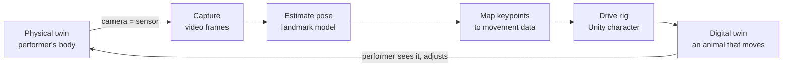

10.01.26

# TDF Journal — 10.01

> **Focus:** Starting the digital twin pipeline: Unity, computer vision tools, and turning sensor data into something delightful
> **Covers:** 09.29.26 → 10.01.26

<!-- DRAFT: Unity install and test-project times come from file timestamps. Anything marked TODO is something only I know. -->

---

## Assignment

- Teachable Machines: [Google Drive Link](https://drive.google.com/drive/folders/1yU7r-dZgeDKUK6F1bUSAJIduy8nO6u4j?usp=drive_link)
- Setting up the pipeline for the digital twin project: Unity, plus the computer vision tools we'd feed into it

---

## 1. Getting Unity running

| When | What |
|---|---|
| 09.29 ~15:35 | Installed Unity Hub and the Unity 6 editor (6000.6.3f1) |
| 09.29 ~16:50 | Created a first test project from the Universal 3D (URP) template |
| 09.29 ~17:05 | Put the test project under Git with a README: [etb4311/unity-test](https://github.com/etb4311/unity-test) |
| 09.30 → 10.01 | Getting comfortable in the editor |

- **What I did:** Installed Unity and made a throwaway project to learn the editor before any real project depended on it. I set it up the way a real project would be: URP for rendering, the new Input System, and Git tracking only `Assets/`, `Packages/` and `ProjectSettings/` (Unity regenerates everything else).
- **Getting comfortable meant learning Unity's own vocabulary:**
  - **Scene and Hierarchy:** the world, and the list of everything in it
  - **GameObjects and components:** everything is an object, and behaviour comes from the components attached to it
  - **Inspector:** where each component's settings live, and where most tuning happens without code
  - **Play mode:** the world runs, but changes made while playing are thrown away when you stop
  - **Prefabs:** reusable objects, like the rigged animal we'd later drive
- **What happened / what I learned:** TODO (what was confusing at first, what clicked, any tutorial I followed).

<!-- TODO: screenshot of the test project in the editor → Week6/assets/10-01/unity-first-scene.png -->

---

## 2. Two kinds of "virtual environment"

Tuesday's lecture (09.29) named two kinds of virtual environment, and the project needs both:

| | Software environment | Simulated environment |
|---|---|---|
| Manages | Computation | A world |
| Our tool | A Python `venv` running the computer vision models | Unity |
| Job in the twin | Read the body from the camera | Recreate the body as something you can see |

Neither one is the digital twin by itself. The twin comes from **integrating** them: the Python side measures the physical world, and the Unity side rebuilds it digitally, live. That made the first engineering question clear: how do the two talk to each other? (We later connected them with local network messages; see [10.15](../Week8/10_15_26.md).)

---

## 3. Carrying computer vision over into a digital twin

Weeks 5 and 6 gave me a set of computer vision tools. Here's how each one maps onto a twin of a performer's body:

| CV tool (09.22) | What it outputs | What it can do in a digital twin |
|---|---|---|
| **Classifier** (e.g. Teachable Machine) | One label per image | Recognize a gesture as a discrete command: "this is a fist" |
| **Detection** (09.24) | A box, a label and a confidence score | Spot a prop or object in frame and where it is |
| **Segmentation** ("signifier" in my notes) | A class for every pixel | Separate a performer from the background |
| **Landmarks** | Named body points, each with a visibility score | Track the skeleton continuously; this is what drives a rig |

The lecture's model pipeline, **Capture → Estimate pose → Map keypoints → Drive rig**, is the backbone of the project:

The loop at the end is what separates a digital twin from a recording. The performer watches the digital body and changes what the physical body does, live.

**Key difference from the Teachable Machine work:** a classifier answers "which category is this?" once per image. A twin needs **continuous** values (how high is the hand, how far is the lean) so movement can be smooth, with discrete classes only for moments like a single gesture.

---

## 4. From data to delight

The sensor data here is gestural: hand heights, leans, hand shapes. The obvious way to show it is as numbers or charts. The idea I want to carry into the project is to recreate it as **behaviour** instead:

- **The same data, a different body.** A raised hand doesn't just move a dot; it moves an animal's leg or turns it. Translating the data, rather than mirroring it, is what makes it surprising.
- **Delight comes from responsiveness.** If the digital body reacts immediately and believably, people play with it. If it lags or jitters, they stop.
- **Discrete gestures become moments.** A held gesture can trigger a whole animation (eating, drinking) instead of a single number changing.
- **It can be shared.** If several people's data drives one body, the twin becomes something a group performs together.

TODO (in my own words: what "delightful" means for this project, and why an animal rather than a human avatar).

---

## Reflections

- Learning Unity on a throwaway project first meant mistakes didn't cost a real project anything.
- The CV tools from weeks 5–6 aren't separate exercises: each one is a candidate input channel for the twin.
- The hardest part isn't any single tool but the integration: getting the software environment and the simulated environment to share data every frame.
- TODO: what I'd do differently in setup.

**Looking back (added 10.15):** These ideas held up. The final project uses a pose **landmark** model for continuous movement, a gesture **classifier** for discrete actions (fist → eat, peace sign → drink) and an object **detector** for a phone that makes the elephant drift. See [10.08](../Week7/10_08_26.md).

---

## Speculations/Questions

- How much latency can a performer tolerate before the twin stops feeling like *their* body?
- Should the twin copy the performer's movement exactly, or translate it into something the animal would do?
- What happens when two or three people's data drive one body?
- Which non-visual sensors (sound, heart rate, touch) could add to a camera-based twin?
