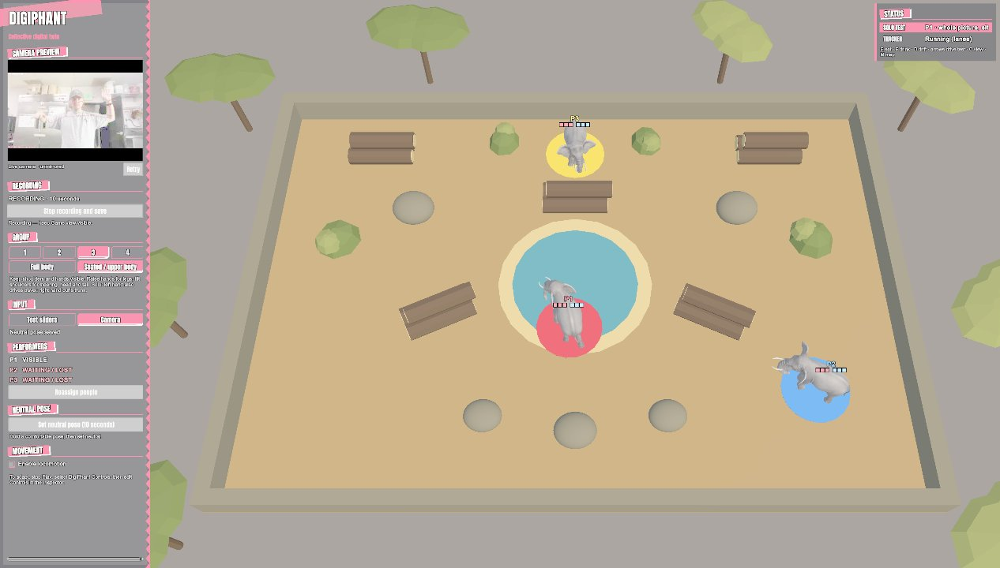
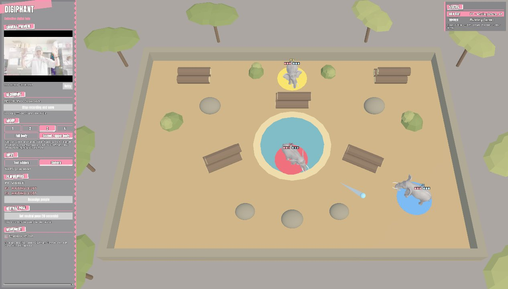
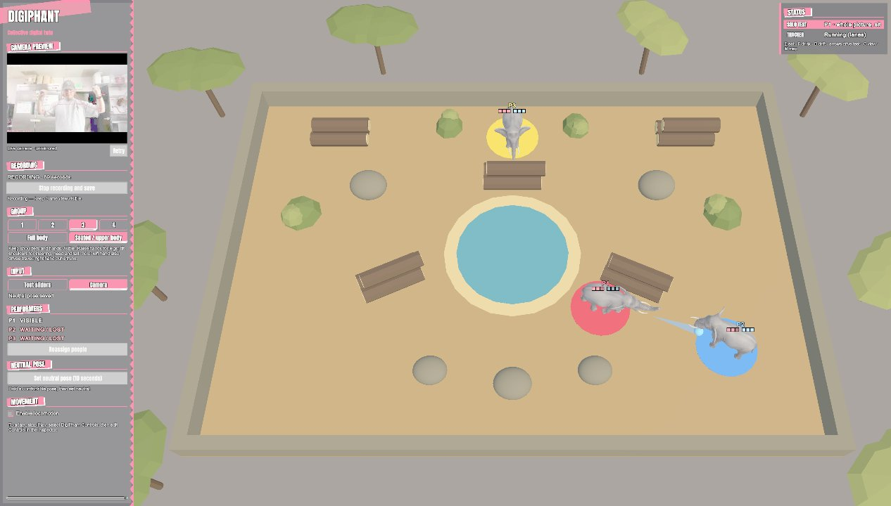

10.13.26

# TDF Journal — 10.13

> **Project:** DigiPhant (Digital Twins) · Team Deadweight
> **Covers:** 10.09.26 → 10.13.26, course camera, interface, the Tank Battle mode and its first recorded test

<!-- DRAFT: filled in from the project files, the 10.09 recording and my working sessions. Anything marked TODO is something only I know. Times are approximate, taken from file timestamps. -->

---

## Contents
1. [Schedule](#1-schedule)
2. [Course camera: changes in order](#2-course-camera-changes-in-order)
3. [Interface: changes in order](#3-interface-changes-in-order)
4. [Tank Battle: built in phases](#4-tank-battle-built-in-phases)
5. [Recorded test: Tank Battle, solo](#5-recorded-test-tank-battle-solo)
6. [10.13: the camera again, and switching modes](#6-1013-the-camera-again-and-switching-modes)
7. [Iteration: one elephant → one elephant each](#7-iteration-one-elephant--one-elephant-each)
8. [Reflection](#8-reflection)

---

## 1. Schedule

| Date / time | Work |
|---|---|
| 10.09 ~12:40–13:05 | Course camera: chase view, north-up view, whole-course view, minimap |
| 10.09 ~13:00–13:35 | Deadweight theme for the interface; control panel regrouped |
| 10.09 ~14:10 | Tank Battle phases 1–2: camera lanes, arena, keyboard driving |
| 10.09 ~14:40–14:50 | Phase 3: pond, drinking and gestures |
| 10.09 ~15:00 | Solo test mode, so one person can test with the camera |
| 10.09 15:20 | **Recorded a 2-minute solo test** of drinking and water shots (section 5) |
| 10.09 ~15:30–15:50 | Phase 4–5: shot changes after the test, then rounds, HUD and arena camera |
| 10.13 | Camera failure in Tank Battle; same cause as 10.08 |

---

## 2. Course camera: changes in order

I have no screenshots of the early camera versions, so this is the sequence of changes and why each one was made.

| # | Version | What changed | Why |
|---|---|---|---|
| 1 | Starter follow camera | The camera slid along with the elephant but kept a fixed angle | It came with the starter |
| 2 | Locked third person (10.08) | Parented the camera to the elephant in the Inspector, no code | With version 1, the view didn't turn when the elephant turned |
| 3 | Course Camera script (10.09) | Three views: **chase** (behind and above, default), **north-up** (never rotates), **whole course**. **C** cycles them | With hand motors, a left turn should always look like a left turn. In the chase view, up on screen is always forward. In north-up, steering looks reversed whenever the elephant heads down the screen |
| 4 | Minimap added | Top-down map of the course; the orange arrow is the elephant. **M** toggles it | The chase view shows only the area near the elephant; the map shows where it is on the whole course |
| 5 | Minimap fix | The minimap now draws into a texture instead of acting as a second camera | **Failed output:** as a second camera it covered the control panel and the camera preview |

<!-- TODO: pull a clip of the chase camera from our Drive recordings → assets/10-13/chase-camera.png -->

---

## 3. Interface: changes in order

| # | Version | What changed | Why |
|---|---|---|---|
| 1 | Starter panels | Unity's default grey panels in one long list | It came with the starter |
| 2 | Regrouped | The panel split into sections: camera preview, recording, group, input, performers, neutral pose, movement, body sliders | A readable panel that the theme could style section by section |
| 3 | Deadweight theme | Persona 5-inspired look: ink-black panels, slanted section banners, the Anton typeface, outlined text | TODO (in my own words: why this look) |
| 4 | Status card | One card in the top right for gestures, drift, hand motors and camera view. A row lights up while it's active | One place to check what the system is reading, instead of a separate label from each script |
| 5 | Scale setting | One `uiScale` setting (default 1.3) resizes the whole interface | Text had to be readable from a few metres away |

The themed panel is visible on the left of the stills in section 5.

---

## 4. Tank Battle: built in phases

- **What I did:** Built a separate 2–3 player game in its own folders, without touching the main scene. Each player drives their own elephant, drinks at the pond with ✌️ to load water, and shoots water balls with ✊.
- **Why:** TODO (in my own words: what made us try a competitive mode alongside the shared performance).
- **How:** Five phases, each with an automated check in Unity's menu, so a later phase couldn't quietly break an earlier one.

| Phase | What changed | Why / what we learned |
|---|---|---|
| 1. Camera lanes | The camera image splits into vertical lanes, and the lane you sit in is your player number | In the course mode nobody can start until all three people are visible. Lanes let each player be picked up on their own. A newcomer has to be clearly inside a lane, so someone on a boundary doesn't flicker between two players. Seated play keeps three people inside one camera shot |
| 2. Arena | A walled arena with cover, logs and boulders; elephants driven by keyboard first | Keyboard first, so driving and collisions could be tested without the camera. **The first 36 × 24 arena was too cramped** for elephants about 4 m across, so it grew to 44 × 30 |
| 3. Pond and ammo | Hold ✌️ in the pond for about 2.2 s to fill 3 shots; you can't drink outside the pond | A reason to move around the arena and to take risks |
| Solo test | **F1** lets the whole picture drive one player, with no lanes | So one person can test gestures with the camera without the whole team |
| 4. Shots and hits | ✊ fires a water ball in the shooter's colour; it bounces; 3 hearts each | See the changes after the recorded test below |
| 5. Rounds and HUD | Practice, 3-2-1 countdown, first to 2 round wins, player cards along the bottom | Turns free play into a match |

**Phase 4 changes** (saved about 10–30 minutes after the recorded test, going by file times):
1. **Steady aim.** While a fist is showing, the elephant stops turning. Closing your hand could briefly read as "one hand up", which turned the elephant and threw the aim off.
2. **Point-blank shots.** The ball now starts inside the shooter, so a wall or elephant right in front of the trunk is always hit and can't be shot through.
3. **Bounces.** Shots bounce twice and can hit their own shooter after a bounce, so firing into a wall at close range is risky.

```python
# tank_bridge.py
"""Fixed vertical lanes: each lane follows at most one body, independently of the others."""
```

---

## 5. Recorded test: Tank Battle, solo

On 10.09 at 15:20 I recorded a 2-minute solo test with the built-in recorder (500 frames at 10 fps, exported to MP4). I drove P1 (red) with my hands while the other two elephants stood still.


*About 15 s in: P1 (red) has driven into the pond to drink. The camera preview on the left shows me in solo-test mode.*


*About 40 s in: a water ball flies from P1 toward P2 (blue). The status card in the top right reads "SOLO TEST: P1 · whole picture".*


*About 90 s in: P1 has driven around the logs to fire at P2 from close range.*

- **What happened / what I learned:** Driving into the pond and shooting both worked with gestures alone. TODO (what felt wrong in the test: did the aim swing when you made a fist?)

---

## 6. 10.13: the camera again, and switching modes

### Failed output: the camera again
- **What happened:** Starting Tank Battle gave `Camera stopped delivering frames.` again. Same cause as 10.08: my iPhone was listed as a camera through Continuity Camera. Turning it off fixed it.
- **What I learned:** It belongs on a pre-performance checklist, not in my memory.

### Switching between modes
- **What I did:** Worked out how to move between the obstacle course and Tank Battle: stop Play, open the other scene, press Play. Each scene starts its own tracker.
- **What happened / what I learned:** The two trackers share network ports, so only one can run at a time, and each mode needs its own calibration. A switch button (phase 6) is still to do.

---

## 7. Iteration: one elephant → one elephant each

| | Obstacle course | Tank Battle |
|---|---|---|
| People per elephant | 3 share one | 1 each |
| Camera | One view; wait for all 3 | Split into lanes; each lane independent |
| If someone leaves | The whole elephant waits | Only their elephant stops |
| Goal | Shared performance | Competitive match |

The same tracking and gestures support two opposite ideas about the group: in the course mode the group is one body, and in Tank Battle the group becomes opponents. The full comparison diagram is in the [10.15 entry](10_15_26.md).

---

## 8. Reflection

- **Test early, then change.** The steady-aim and point-blank fixes landed right after the recorded test. TODO (confirm the test is what prompted them).
- **Build in phases with checks.** Each Tank Battle phase had its own validation, so problems showed up one at a time.
- **Design for the performer's eyes.** The camera views, the status card and the larger interface were all about reading the screen from a distance while moving.
- **Checklists beat memory.** The same iPhone problem came back five days later.
- TODO: which mode the team prefers for the final performance, and why.
