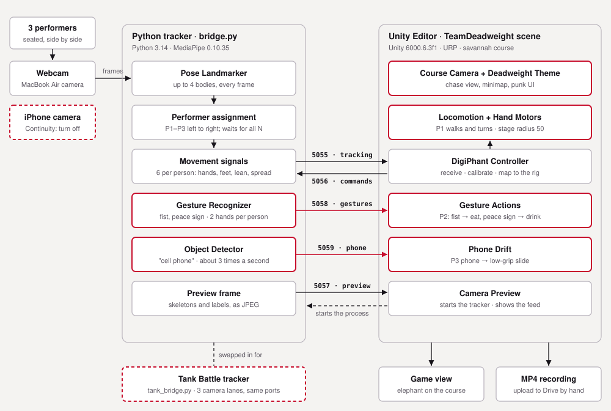
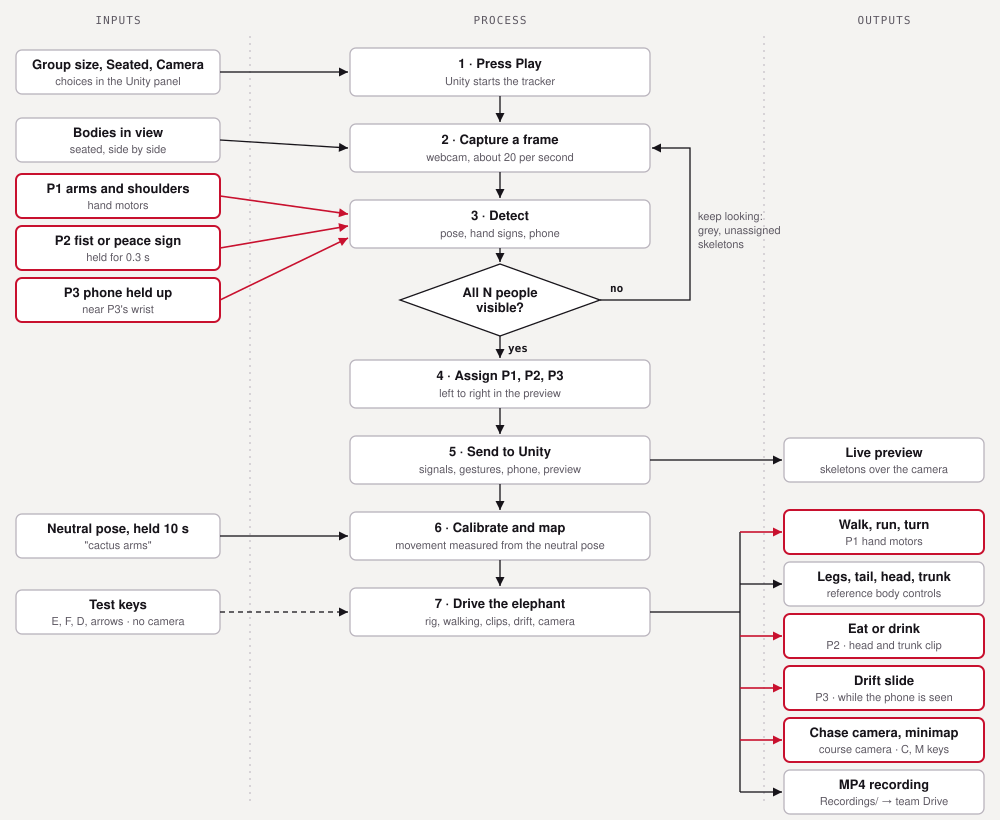
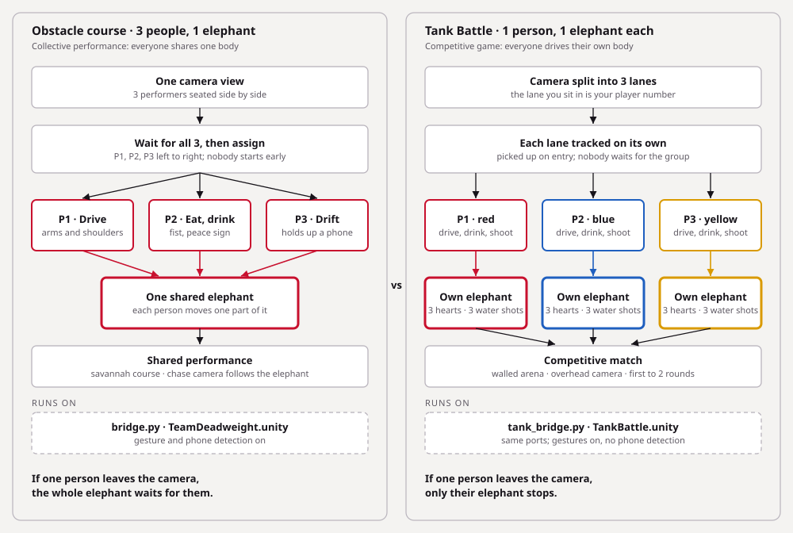

10.15.26

# TDF Journal — 10.15

> **Project:** DigiPhant (Digital Twins) · Team Deadweight
> **Covers:** 10.15.26, system diagrams, synthesis and deliverable planning

<!-- DRAFT: filled in from the project files and my working sessions. Anything marked TODO is something only I know. -->

---

## Contents
1. [Process Documentation](#1-process-documentation)
2. [System Diagrams: How It Works](#2-system-diagrams-how-it-works)
3. [Where the project stands](#3-where-the-project-stands)
4. [Reflection](#4-reflection)

---

## 1. Process Documentation

### Diagramming the system
- **What I did:** Drew three diagrams of how DigiPhant works: a system architecture, a process flow from inputs to outputs, and a comparison of the two modes. I built them in Figma so the team can edit them.
- **Why:** After a week of fixes spread across Python, Unity and the camera, I needed one picture of where data actually goes. It also showed which parts our team built and which came from the starter.
- **What happened / what I learned:** Failed output: the first version was a web page, which I couldn't open, and the Figma connection dropped partway through the session. I exported the diagrams as SVG files and imported those into Figma once it reconnected. Every box and label is now an editable layer.
- **Next step:** Add a diagram that states the difference between the two modes directly.

### Iteration: comparing the two modes
- **What I did:** Added a third diagram that runs both modes through the same steps side by side.
- **What happened / what I learned:** The difference is easiest to see in the arrows. In the obstacle course, three people's inputs **converge** on one elephant; in Tank Battle, each player's inputs run **in parallel** to their own elephant. Drawing it also made me notice the failure behaviour: if one person leaves, the shared elephant waits, but a Tank Battle elephant just stops.

### Planning the deliverables
- **What I did:** Checked the project against the two assignments: the process documentation and the project files.
- **What happened / what I learned:** The diagrams cover the "at least 2 diagrams" requirement. The biggest risk was that the team repo had only its first commit; my partner is now preparing the project files. I'm writing the reflection myself.

---

## 2. System Diagrams: How It Works

*These diagrams show how the system functions (inputs, processing, decisions, outputs), not what the interface looks like.*

Editable versions: [Team Deadweight DigiPhant Diagrams (Figma)](https://www.figma.com/design/kZbYYbKVw5laooiMFUbTrT) <!-- TODO: in Figma, Share → "Anyone with the link can view" so instructors can open it -->

### Diagram 1: System architecture

**Walkthrough:**
1. **Input:** Three seated performers in front of the MacBook webcam. The iPhone is drawn dashed because it interfered with the camera twice.
2. **Processing (Python):** The tracker owns the camera. It runs three MediaPipe models: pose (from the starter), plus gesture and phone detection (ours, outlined in red). It assigns P1–P3 left to right and turns each body into six movement numbers.
3. **Connection:** The two programs only talk through local network messages, each on its own port: 5055 tracking, 5058 gestures, 5059 phone, 5057 camera preview, and 5056 for commands back from Unity. Nothing leaves the laptop.
4. **Processing (Unity):** The controller calibrates against each performer's neutral pose and maps movement to the elephant. Our scripts add hand motors, eat and drink, drift, the course camera and the theme.
5. **Output:** The Game view and an MP4 recording. Tank Battle swaps in its own tracker on the same ports.

### Diagram 2: Process flow, inputs to outputs

**Walkthrough:**
1. **Inputs:** Panel choices, bodies in view, P1's arms, P2's hand signs, P3's phone, the 10-second neutral pose, and test keys for working without a camera.
2. **Decision:** The one gate in the loop: are all N people visible? If not, the tracker keeps looking and shows grey, unassigned skeletons.
3. **Processing:** Assign → send to Unity → calibrate against the neutral pose → drive the elephant.
4. **Outputs:** The live preview, walking and turning, body movement, eat or drink, drift, the chase camera and the recording.

### Diagram 3: Two modes compared

**Walkthrough:** Both modes use the same camera, models and gestures. The obstacle course waits for all three people and merges their inputs into **one shared elephant**. Tank Battle splits the camera into lanes, tracks each one independently, and gives **each player their own elephant**.

---

## 3. Where the project stands

| Part | Status |
|---|---|
| Obstacle course: 3 people, 1 elephant | Built; gestures and phone tested live; full 3-person run still to do |
| Tank Battle | Phases 1–5 built; phase 5 waiting for a playtest; phase 6 (switching modes) not started |
| Recordings | A 2-minute solo Tank Battle test from 10.09 (MP4); no obstacle-course performance recorded yet |
| Diagrams | 3 done (Figma + SVG) |
| Team repository | Being prepared by my partner |

---

## 4. Reflection

- **Diagrams found what testing hadn't.** Drawing the two modes side by side surfaced how differently they fail when someone leaves, which we hadn't discussed as a team.
- **Mark what's ours.** Colour-coding the starter versus our additions made our contribution easy to see, for the professors and for us.
- **Plan the hand-in before the last day.** Checking the deliverables early showed the repository was the real risk, not the code.
- TODO: one tested improvement and one remaining limitation (group reflection).
